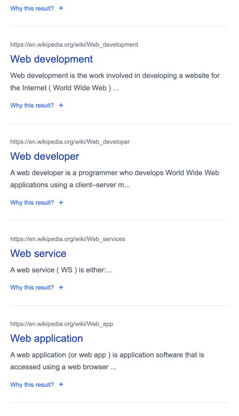

# SearchEngine

Search 3,062 Wikipedia articles with TF-IDF and PageRank. Open **Why this result?**
to see matched terms and how each ranking component contributes to the score.

Try **web**, **MapReduce**, or **artificial intelligence**. Search covers the
bundled collection, not the live web.



## Features

- Simple blue and white interface with example searches.
- Concurrent search across three index segments.
- Expandable ranking explanations.
- SQLite document metadata.

## Run locally

Requires Python 3.12+.

```sh
python3 -m venv .venv
source .venv/bin/activate
pip install Flask requests beautifulsoup4 pytest
python bin/build-index
python bin/searchdb
```

Activate the environment in four terminals, then run one command per terminal:

```sh
PYTHONPATH=index_server INDEX_PATH=index_server/index/inverted_index/inverted_index_0.txt flask --app index run --port 9000
PYTHONPATH=index_server INDEX_PATH=index_server/index/inverted_index/inverted_index_1.txt flask --app index run --port 9001
PYTHONPATH=index_server INDEX_PATH=index_server/index/inverted_index/inverted_index_2.txt flask --app index run --port 9002
PYTHONPATH=search_server flask --app search run --port 8000
```

Open [localhost:8000](http://localhost:8000).

## Ranking

Documents must match all non-stopword query terms. The default score blends
TF-IDF cosine relevance and PageRank equally:

`score = (1 - w) × text_relevance + w × pagerank`

API: `/api/v1/hits/?q=mapreduce&w=0.5&explain=1`.

## Tests

```sh
PYTHONPATH=index_server:search_server python -m pytest tests/test_explanations.py -q
```
